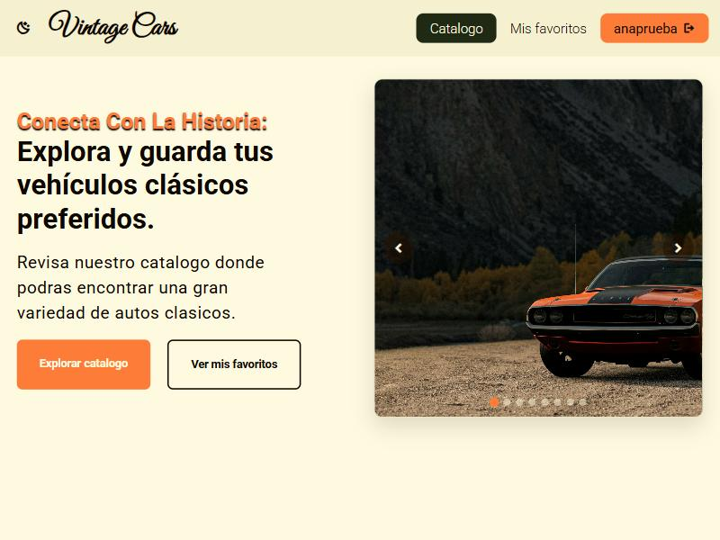
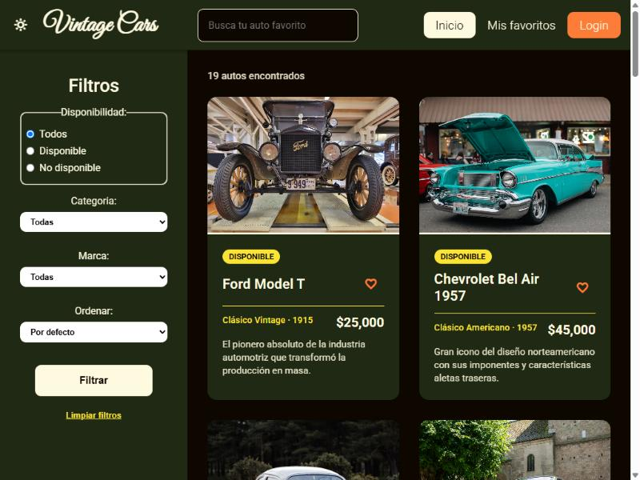
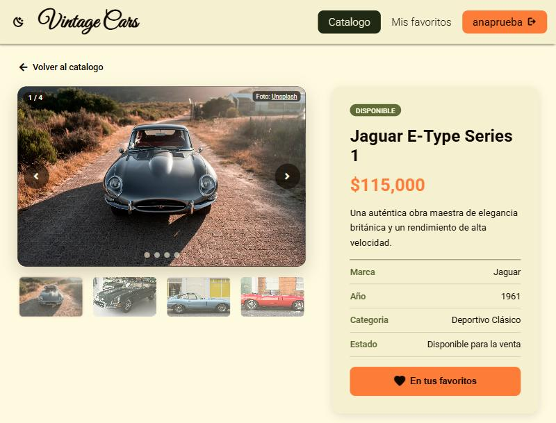
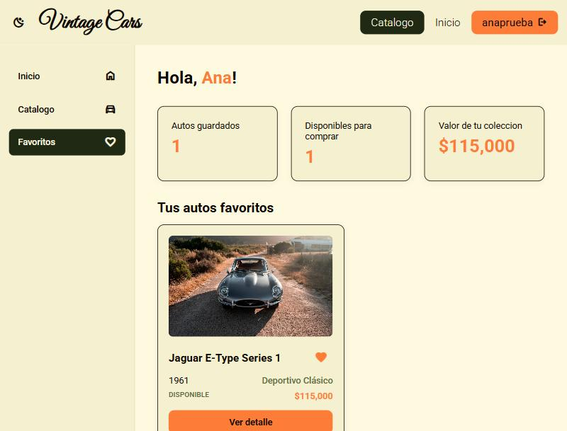

# 🚗 Vintage Cars

Catalogo web de autos clasicos hecho con **Node.js + Express** y JavaScript sin frameworks. Podes explorar los autos, filtrarlos, ver cada uno en detalle con un slider de fotos y, con tu cuenta, guardar tus favoritos.


| Inicio | Catalogo |
| --- | --- |
|  |  |
| **Detalle con slider** | **Panel de favoritos** |
|  |  |

## ✨ Funcionalidades

- **Catalogo** con buscador en vivo y filtros por disponibilidad, categoria, marca y precio. Los filtros quedan en la URL, asi que se pueden compartir.
- **Vista de detalle** de cada auto con slider de fotos (flechas, puntos, miniaturas, teclado y avance automatico), ficha tecnica y autos relacionados.
- **Registro e inicio de sesion** con contraseñas hasheadas (scrypt) y sesion en una cookie `httpOnly` firmada.
- **Favoritos por usuario**: guarda o quita autos con el corazon y miralos en tu panel con un resumen de tu coleccion.
- **Modo claro / oscuro** que se recuerda entre visitas.
- **Diseño responsive**: menu y filtros como paneles laterales en el celular.

## 🛠️ Tecnologias

- **Backend:** Node.js, Express 5, `dotenv`. Sin base de datos externa: los usuarios se guardan en un archivo JSON.
- **Frontend:** HTML, CSS (metodologia BEM) y JavaScript con ES Modules, sin frameworks.
- **Seguridad:** `crypto` de Node para hash de contraseñas (scrypt) y firma HMAC de la sesion.

## 🚀 Como correrlo

Requisitos: [Node.js](https://nodejs.org/) 18 o superior.

```bash
git clone https://github.com/Cheeskoo/vintage-cars-remake.git
cd vintage-cars-remake
npm install
cp .env.example .env
```

Edita `.env` y pone un texto largo y aleatorio en `SESSION_SECRET`. Despues:

```bash
npm run dev     # con recarga automatica (nodemon)
# o
npm start
```

Abri [http://localhost:3000](http://localhost:3000).

### Variables de entorno

| Variable | Descripcion | Por defecto |
| --- | --- | --- |
| `PORT` | Puerto del servidor | `3000` |
| `SESSION_SECRET` | Clave para firmar las cookies de sesion | Una temporal (las sesiones se pierden al reiniciar) |

## 📁 Estructura

```
├── server.js              # Servidor Express y montaje de rutas
├── routes/
│   ├── carsRouter.js      # Catalogo, filtros y detalle
│   ├── authRouter.js      # Registro, login, logout y usuario actual
│   └── favoritesRouter.js # Favoritos del usuario logueado
├── lib/
│   ├── auth.js            # Hash de contraseñas, cookie de sesion y middlewares
│   └── store.js           # Lectura/escritura de data/users.json
├── data/
│   └── cars.js            # Catalogo de autos con sus galerias de fotos
└── public/                # Frontend
    ├── index.html         # Inicio
    ├── html/              # catalogo, auto (detalle), login, dashboard, 404
    ├── css/               # Estilos por pagina + components.css compartido
    └── js/                # Logica por pagina + modulos en js/script/
```

## 🔌 API

| Metodo | Ruta | Descripcion |
| --- | --- | --- |
| `GET` | `/api/cars` | Lista de autos. Query opcionales: `buscar`, `categoria`, `marca`, `disponible` (`true`/`false`), `orden` (`ASC`/`DESC`) |
| `GET` | `/api/cars/filtros` | Categorias y marcas disponibles |
| `GET` | `/api/cars/:id` | Detalle de un auto con su galeria |
| `POST` | `/api/auth/register` | Body: `{ nombre, apellido, correo, usuario, password }` |
| `POST` | `/api/auth/login` | Body: `{ usuario, password }` (acepta usuario o correo) |
| `POST` | `/api/auth/logout` | Cierra la sesion |
| `GET` | `/api/auth/me` | Usuario logueado o `null` |
| `GET` | `/api/favorites` | Autos guardados 🔒 |
| `POST` | `/api/favorites/:carId` | Guardar un auto 🔒 |
| `DELETE` | `/api/favorites/:carId` | Quitar un auto 🔒 |

🔒 Requiere sesion iniciada (si no, responde `401`).

Ejemplo:

```bash
curl "http://localhost:3000/api/cars?buscar=porsche&orden=DESC"
```

## 🧭 Cosas a mejorar

Ideas para seguir creciendo el proyecto:

**Datos y backend**
- [ ] Pasar de `data/users.json` a una base de datos real (SQLite, PostgreSQL o MongoDB). El archivo JSON no escala y no soporta varios servidores a la vez.
- [ ] Guardar tambien el catalogo de autos en la base de datos y agregar un panel de administracion para cargar, editar y borrar autos.
- [ ] Paginar el catalogo (`?pagina=` y `?limite=`) para cuando haya muchos autos.
- [ ] Validar los datos de entrada con una libreria como `zod` o `express-validator`.

**Seguridad**
- [ ] Limitar los intentos de login (`express-rate-limit`) para frenar ataques de fuerza bruta.
- [ ] Agregar cabeceras de seguridad con `helmet`.
- [ ] Recuperar contraseña por correo y verificar el email al registrarse.
- [ ] Permitir cerrar sesion en todos los dispositivos (hoy la cookie vale hasta que vence).

**Experiencia de usuario**
- [ ] Pagina de perfil para editar los datos de la cuenta y cambiar la contraseña.
- [ ] Filtro por rango de precio y por año.
- [ ] Ver las fotos del slider en pantalla completa y deslizarlas con el dedo con mejor respuesta en el celular.
- [ ] Comparar dos o tres autos lado a lado.
- [ ] Guardar las fotos en el propio proyecto o en un CDN, en vez de depender de enlaces externos que pueden dejar de funcionar.

**Calidad del codigo**
- [ ] Tests automaticos de la API (por ejemplo con `node:test` + `supertest`) y de la interfaz con Playwright.
- [ ] Unificar las variables y estilos que se repiten en cada CSS en un archivo base comun.
- [ ] Configurar ESLint y Prettier, y un flujo de GitHub Actions que los corra en cada push.
- [ ] Publicar el proyecto (Render, Railway o similar) y poner el enlace en este README.

## 📸 Creditos de imagenes

Las fotos del catalogo provienen de [Unsplash](https://unsplash.com) y [Wikimedia Commons](https://commons.wikimedia.org). Cada foto del slider muestra un enlace a su fuente original.

## 👤 Autor

**Franco Calderon** · [@Cheeskoo](https://github.com/Cheeskoo)

Proyecto realizado como practica de Express.
